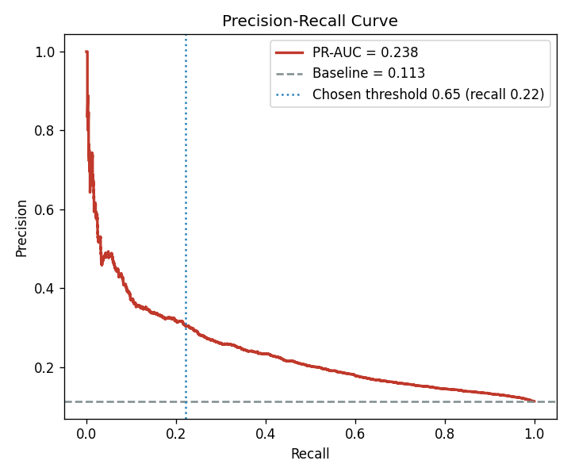
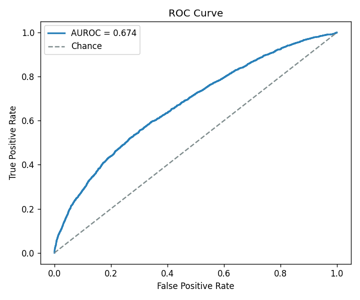
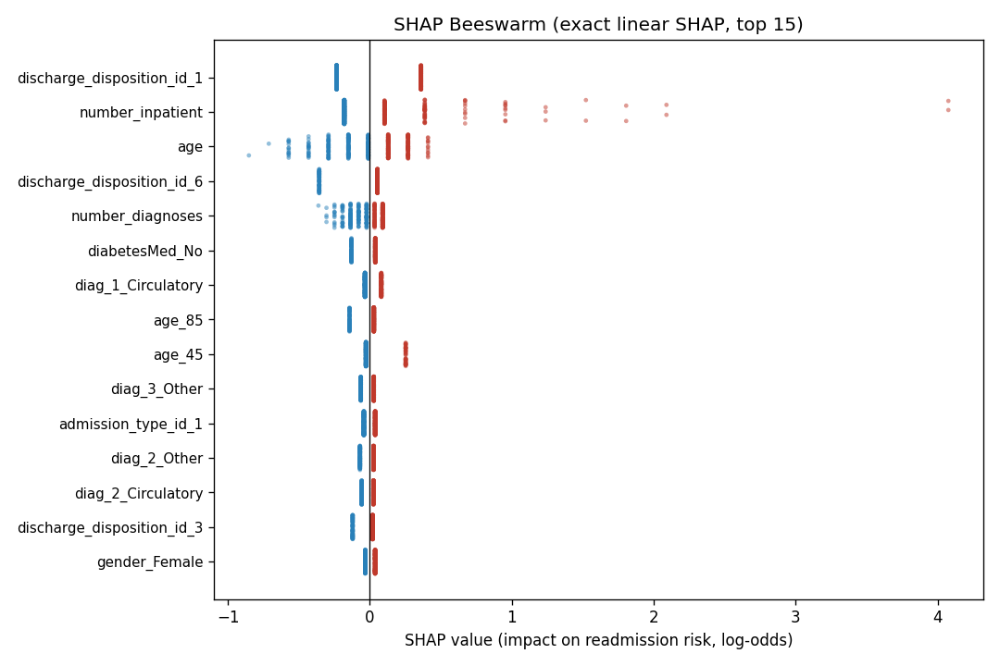
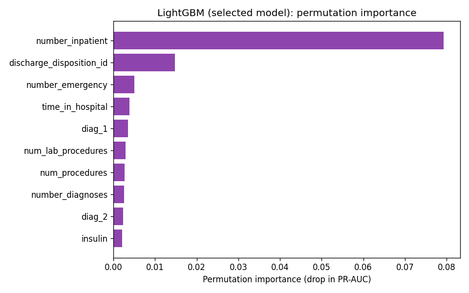

# 🏥 Diabetes 30-Day Readmission Prediction

<div align="center">


**End-to-end ML pipeline predicting hospital readmission within 30 days from the UCI Diabetes 130-US Hospitals dataset.**

[📓 Open in Colab](https://colab.research.google.com/github/AbdulrazaqSultan/diabetes-readmission-prediction/blob/main/notebooks/colab_main.ipynb) · [📊 View Metrics](reports/metrics.md) · [📖 الدليل الشامل بالعربية (Arabic Guide)](docs/PROJECT_SUMMARY_AR.md) · [🤗 Dataset](https://archive.ics.uci.edu/dataset/296/diabetes+130-us+hospitals+for+years+1999-2008)

</div>

---

## 📋 Project Overview

| Item | Detail |
|------|--------|
| **Dataset** | UCI Diabetes 130-US Hospitals (1999–2008) |
| **Records** | 101,766 encounters · 69,987 unique patients |
| **Task** | Binary classification: readmitted within 30 days? |
| **Best model** | LightGBM (sklearn Pipeline) |
| **PR-AUC** | 0.2383 (95% CI: 0.222 – 0.255) |
| **ROC-AUC** | 0.674 |
| **Threshold** | 0.651 → Recall 22.1% · Precision 30.4% |
| **Leakage guard** | GroupShuffleSplit on `patient_nbr` |

### Honest Performance Disclaimer

> The literature ceiling on this dataset is ROC-AUC ~0.68–0.70 (Strack et al., 2014; multiple replications). Administrative records without vital signs impose a hard information ceiling — the bottleneck is the data, not the model. Our results are on par with published work and validated with proper patient-level splits.

---

## 🗂️ Repository Structure

```
diabetes-readmission-prediction/
│
├── data/raw/
│   ├── diabetic_data.csv          # 101,766 encounters (UCI)
│   └── IDS_mapping.csv            # Code → description mapping
│
├── models/
│   ├── model.joblib               # Best Pipeline (LightGBM)
│   ├── model.onnx                 # ONNX export (cross-platform inference)
│   ├── threshold.json             # Clinical threshold = 0.651
│   ├── feature_schema.json        # Feature schema for Flutter app
│   ├── feature_names.npy          # 176 transformed feature names
│   ├── split_indices.npz          # Train/test indices (reproducible)
│   └── explainability.json        # Top-5 SHAP + permutation importance
│
├── notebooks/
│   ├── 01_eda.ipynb               # Phase 1: Exploratory Data Analysis
│   └── colab_main.ipynb           # 🚀 Full pipeline — open in Colab
│
├── reports/
│   ├── metrics.md                 # Model comparison + threshold + SHAP
│   └── figures/
│       ├── pr_curve.png
│       ├── roc_curve.png
│       ├── confusion_matrix.png
│       ├── calibration.png
│       ├── shap_summary.png       # Exact linear SHAP beeswarm
│       ├── shap_bar.png           # Top-10 mean |SHAP|
│       └── feature_importance.png # LightGBM permutation importance
│
├── src/
│   ├── config.py                  # Paths, constants, feature groups
│   ├── data_loader.py             # load_and_clean(), make_target()
│   ├── preprocess.py              # ICD-9 chapters, ColumnTransformer
│   ├── train.py                   # 5 models + Bootstrap CI
│   ├── evaluate.py                # Threshold selection + 4 figures
│   ├── explain.py                 # Exact SHAP + permutation importance
│   └── export_onnx.py             # ONNX export + parity test
│
├── tests/
│   └── test_onnx_parity.py        # pytest: threshold / model / ONNX parity
│
├── requirements.txt
└── README.md
```

---

## 🚀 Quick Start

### Option A — Google Colab (Recommended)

Click the badge at the top or open `notebooks/colab_main.ipynb`. The notebook:
- Installs all dependencies
- Downloads dataset from UCI automatically
- Runs all 6 phases end-to-end
- Exports ONNX model and verifies parity

### Option B — Local

```bash
# 1. Clone
git clone https://github.com/AbdulrazaqSultan/diabetes-readmission-prediction
cd diabetes-readmission-prediction

# 2. Install
pip install -r requirements.txt

# 3. Download data (manual)
#    Place diabetic_data.csv and IDS_mapping.csv in data/raw/

# 4. Run full pipeline
python -m src.train          # Phase 3: training
python -m src.evaluate       # Phase 4: evaluation + figures
python -m src.explain        # Phase 5: explainability
python -m src.export_onnx --check  # Phase 6: ONNX + parity

# 5. Run tests
pytest tests/ -v
```

---

## 📊 Model Comparison

| Model | PR-AUC | PR-AUC 95% CI | ROC-AUC | Brier |
|-------|--------|--------------|---------|-------|
| 🏆 **LightGBM** | **0.2383** | [0.222, 0.255] | 0.674 | 0.212 |
| LightGBM+Calibrated | 0.2379 | [0.222, 0.255] | 0.674 | **0.096** |
| HistGradientBoosting | 0.2348 | [0.219, 0.252] | 0.675 | 0.217 |
| LogReg_baseline | 0.2255 | [0.211, 0.242] | 0.670 | 0.225 |
| LogReg_L2_C0.1 | 0.2249 | [0.210, 0.241] | 0.671 | 0.225 |
| RandomForest | 0.2081 | [0.194, 0.224] | 0.656 | 0.097 |

> **Note:** Confidence intervals overlap between top-3 models — the PR-AUC gap of ~0.01 is not statistically conclusive. LightGBM is selected by primary metric (PR-AUC).

---

## 🔍 Explainability — Top 5 Features

| Rank | Feature | Interpretation |
|------|---------|---------------|
| 1 | `discharge_disposition_id` | Discharge destination is the strongest predictor; reflects clinical stability and follow-up arrangements |
| 2 | `number_inpatient` | Prior inpatient visits — the classic readmission driver |
| 3 | `age` | Older age → higher predicted risk |
| 4 | `number_diagnoses` | Higher comorbidity burden → higher risk |
| 5 | `time_in_hospital` | Longer current stay → higher risk |

Agreement between linear SHAP and LightGBM permutation importance on features 1 & 2 validates these findings across model families.

---

## 🔬 Engineering Decisions

| Decision | Rationale |
|----------|-----------|
| Keep all encounters (no first-visit filter) | Positive rate 11.4% ✅ vs 8.98% with filter ❌; `patient_nbr` count matches spec's "69k" rows |
| GroupShuffleSplit on `patient_nbr` | Same patient appears up to 40 times → random split leaks |
| ICD-9 → 9 clinical chapters | Reduces cardinality while preserving medical interpretability |
| Threshold = 0.651 (not 0.50) | Clinical rule: max Recall s.t. Precision ≥ 0.30 (missed readmission > false alert) |
| Bootstrap CI (1,000 resamples) | Quantifies whether model differences are noise or signal |
| ONNX export | Cross-platform inference: Flutter app gets raw features → probability without sklearn |

---

## 🏗️ Pipeline Architecture

```
Raw CSV (101,766 rows)
    │
    ▼  clean_data()
Cleaned (99,340 rows, 11.4% positive)
    │
    ▼  prepare_features()
Feature matrix X (50→47 cols, ICD-9 chapters, age midpoints)
    │
    ▼  GroupShuffleSplit(patient_nbr)
Train (79,567) / Test (19,773)
    │
    ▼  Pipeline(ColumnTransformer, LightGBM)
176-dim transformed features → model.joblib
    │
    ├──▶ evaluate.py → threshold.json (0.651) + 4 figures
    ├──▶ explain.py → SHAP values + permutation importance
    └──▶ export_onnx.py → model.onnx + feature_schema.json
```

---

## 📈 Figures

<table>
<tr>
<td><br><em>Precision-Recall Curve</em></td>
<td><br><em>ROC Curve (AUC=0.674)</em></td>
</tr>
<tr>
<td><br><em>SHAP Beeswarm (linear, exact)</em></td>
<td><br><em>LightGBM Permutation Importance</em></td>
</tr>
</table>

---

## 📦 ONNX Inference (Minimal Example)

```python
import onnxruntime as rt, numpy as np, json

sess      = rt.InferenceSession("models/model.onnx")
schema    = json.load(open("models/feature_schema.json"))
threshold = schema["threshold"]  # 0.651

# Build feed dict from raw feature values (same order as schema["feature_groups"])
feed = { ... }   # see notebooks/colab_main.ipynb for full example

proba  = sess.run(None, feed)[1][0][1]
risk   = "HIGH RISK" if proba >= threshold else "low risk"
```

---

## 🧪 Running Tests

```bash
pytest tests/ -v
# ✅ test_threshold_json_valid
# ✅ test_model_joblib_predict
# ✅ test_feature_schema_valid
# ✅ test_onnx_file_exists        (skipped if skl2onnx not installed)
# ✅ test_onnx_parity             (skipped if onnxruntime not installed)
```

---

## 📚 References

1. Strack, B. et al. (2014). [Impact of HbA1c Measurement on Hospital Readmission Rates](https://www.hindawi.com/journals/bmri/2014/781670/). *BioMed Research International*.
2. UCI ML Repository: [Diabetes 130-US Hospitals (1999-2008)](https://archive.ics.uci.edu/dataset/296).
3. Stoltzfus, J. C. (2011). Logistic Regression: A Brief Primer. *Academic Emergency Medicine*.

---

## 📄 License

MIT License — see `LICENSE` for details.

---

<div align="center">
Built with ❤️ using scikit-learn · LightGBM · ONNX Runtime
</div>
