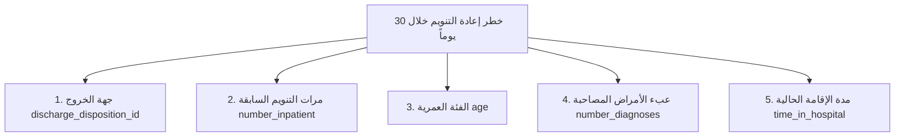

# دليل المشروع الشامل: التنبؤ بإعادة تنويم مرضى السكري (30 يوماً)
## Comprehensive Project Guide: 30-Day Diabetes Hospital Readmission Prediction

> **البرنامج التدريبي:** دورة التدريب الاحترافي لمهندسي الذكاء الاصطناعي (PAEP - Professional AI Engineering Program)  
> **المسار:** تعلم الآلة المتقدم (Machine Learning)  
> **إعداد المهندس:** عبد الرازق سلطان (Abdulrazaq Sultan)  
> **المستودع البرمجي:** [GitHub Repository](https://github.com/AbdulrazaqSultan/diabetes-readmission-prediction)  

---

## فهرس المحتويات (Table of Contents)
1. [المشكلة الطبية والهدف السريري والمالي](#1-المشكلة-الطبية-والهدف-السريري-والمالي)
2. [البيانات والتحديات وهندسة الميزات (Data & Feature Engineering)](#2-البيانات-والتحديات-وهندسة-الميزات)
3. [الخوارزميات المستخدمة وكيفية اختيار النموذج الأفضل](#3-الخوارزميات-المستخدمة-وكيفية-اختيار-النموذج-الأفضل)
4. [المعاملات الفائقة وضبط عتبة القرار السريري (Hyperparameters & Threshold)](#4-المعاملات-الفائقة-وضبط-عتبة-القرار-السريري)
5. [تفسير قرارات النموذج طبياً (Explainable AI - SHAP Analysis)](#5-تفسير-قرارات-النموذج-طبياً-shap)
6. [الجاهزية للإنتاج وتصدير ONNX (Production & Inference)](#6-الجاهزية-للإنتاج-وتصدير-onnx)
7. [الخارطة المستقبلية: دمج التعلم العميق والرؤية الحاسوبية (Deep Learning & CV)](#7-الخارطة-المستقبلية-دمج-التعلم-العميق-والرؤية-الحاسوبية)
8. [بنك الأسئلة المتوقعة في المقابلات ومناقشة المشاريع مع الإجابات النموذجية (Q&A)](#8-بنك-الأسئلة-المتوقعة-في-المقابلات-والمناقشات)

---

## 1. المشكلة الطبية والهدف السريري والمالي

### ما هي المشكلة؟ (The Problem)
مرض السكري (Diabetes Mellitus) مرض مزمن معقد يؤثر على ملايين البشر عالمياً. عند تنويم مريض السكري في المستشفى وخروجه، يواجه خطراً كبيراً لانتكاس حالته الصحية وإعادة تنويمه خلال فترة وجيزة.
* **المعيار الذهبي عالمياً:** إعادة التنويم غير المخطط لها خلال **30 يوماً** من تاريخ الخروج (`Readmission < 30 days`).
* **لماذا 30 يوماً بالتحديد؟**
  1. **معيار جودة الرعاية الصحية:** إعادة المريض خلال 30 يوماً تعني غالباً قصوراً في خطة العلاج، أو عدم استقرار نسبة السكر، أو سوء التنسيق الدوائي عند الخروج، أو غياب المتابعة المنزلية.
  2. **العقوبات المالية (HRRP):** تطبق هيئات الرعاية الصحية (مثل برنامج *Hospital Readmissions Reduction Program - CMS* الأمريكي) عقوبات وخصومات مالية صارمة على المستشفيات التي تسجل معدلات إعادة تنويم مرتفعة تتجاوز المتوسط.

### ما هو الهدف من النظام؟ (The Objective)
بناء نظام تعلم آلي تنبؤي سريري (Clinical Predictive AI Pipeline) يقوم بتحليل بيانات المريض اللحظية أثناء إقامته بالمستشفى، والتنبؤ باحتمالية عودته خلال 30 يوماً قبل لحظة كتابة إذن الخروج.
* **الأثر الواقعي:** يتيح للفريق الطبي التدخل الوقائي المسبق (Preventive Interventions) مثل:
  * تعديل جرعات الإنسولين بدقة قبل الخروج.
  * جدولة زيارة متابعة منزلية أو عيادية مبكرة خلال الأسبوع الأول.
  * توفير توعية مكثفة للمريض وعائلته حول أعراض الهبوط والارتفاع.

---

## 2. البيانات والتحديات وهندسة الميزات

### مصدر البيانات (Dataset)
* **اسم مجموعة البيانات:** UCI Diabetes 130-US Hospitals Dataset (1999–2008).
* **حجم البيانات:** 101,766 زيارة طبية (Encounters) تمثل 71,518 مريضاً فريداً، عبر 50 متغيراً سريرياً وديموغرافياً ودواءً.

### التحديات الهندسية وكيف تم حلها (Challenges & Solutions)

| التحدي الهندسي (Challenge) | طبيعة المشكلة | الحل المطبق في الكود (Pipeline Solution) |
|---|---|---|
| **عدم توازن الفئات الحاد (Class Imbalance)** | الحالات الإيجابية (إعادة التنويم < 30 يوماً) تمثل **11.35%** فقط من البيانات، بينما 88.65% لم يعودوا أو عادوا بعد 30 يوماً. | عدم الاعتماد على مقياس الدقة التقليدي (Accuracy)؛ استخدام **PR-AUC** كمقياس أساسي، وتطبيق أوزان الفئات (`scale_pos_weight`). |
| **تسرب البيانات (Data Leakage)** | المريض الواحد يتكرر في البيانات حتى 40 زيارة. لو تم التقسيم العشوائي العادي (Random Split)، ستدخل زيارات لنفس المريض في التدريب والاختبار معاً! | استخدام **`GroupShuffleSplit`** بالاعتماد على معرف المريض الفريد `patient_nbr` (80% تدريب: 79,567 زيارة / 20% اختبار: 19,773 زيارة). |
| **القيم المفقودة الكثيفة (Missing Values)** | قيم ممثلة بالرمز `?`، وبعض الأعمدة تتجاوز نسبة الفقدان فيها 40% مثل الوزن (`weight` 97%) والتخصص الطبي (`medical_specialty` 49%). | إسقاط الأعمدة التي تتجاوز نسبة الفقدان فيها 40%؛ واستخدام `SimpleImputer(strategy='most_frequent')` للبيانات الفئوية و`median` للرقمية. |
| **الرموز التشخيصية الطبية المعقدة (ICD-9 Codes)** | رموز التشخيص للثلاث حالات الأولية (`diag_1`, `diag_2`, `diag_3`) تزيد عن 800 رمز طبي مفصل يصعب تدريبه مباشرة. | تحويل وتجميع الرموز الطبية إلى **9 فصول تشخيصية سريرية رئيسية (Clinical ICD-9 Chapters)**: أمراض الدورة الدموية، السكري، الجهاز التنفسي، الجهاز الهضمي، الأورام، وغيرها. |
| **المتغيرات الدوائية (Medications)** | 23 دواء للسكري مسجل بحالات: (No, Steady, Up, Down). | تحويلها إلى ترميز عددي وفئوي يعكس ما إذا كان الدواء قد تم تغييره أو استقراره. |

* **إجمالي الميزات بعد المعالجة:** تم إنتاج **176 ميزة رقمية وفئوية مجهزة** عبر `ColumnTransformer`.

---

## 3. الخوارزميات المستخدمة وكيفية اختيار النموذج الأفضل

تمت مقارنة **5 خوارزميات ونماذج مختلفة** لاختيار النموذج المتصدر سريرياً وإحصائياً:
1. **Logistic Regression (L2 Regularized Baseline):** خط الأساس الخطي المعياري.
2. **Logistic Regression (C=0.1):** نموذج خطي مقيد للحد من فرط التخصيص.
3. **Random Forest Classifier:** خوارزمية تجميعية معتمدة على الأشجار المعبأة (Bagging).
4. **HistGradientBoosting Classifier:** نموذج تعزيز التدرج المبني على تجزئة الخانات (Histogram-based).
5. **LightGBM Classifier:** نموذج تعزيز التدرج الحديث وفائق السرعة القائم على نمو الأشجار الرأسي (Leaf-wise Tree Growth).

### جدول المقارنة والنتائج التجريبية (Empirical Results on Test Set - 19,773 encounters)

| النموذج (Model) | PR-AUC (المقياس الأساسي) | فترة الثقة 95% لـ PR-AUC | ROC-AUC | وقت التدريب (ثوانٍ) | القرار السريري |
|:---|:---:|:---:|:---:|:---:|:---:|
| 🏆 **LightGBM** | **0.2383** | **[0.222 , 0.255]** | **0.6739** | **4.1s** | **النموذج الفائز والمعتمد (Best)** |
| **LightGBM (Calibrated)** | 0.2379 | [0.222 , 0.255] | 0.6744 | 19.1s | ممتاز للمعايرة الاحتمالية البحتة |
| **HistGradientBoosting** | 0.2348 | [0.219 , 0.252] | 0.6753 | 7.9s | أداء مقارب جداً لـ LightGBM |
| **Logistic Regression (Base)** | 0.2255 | [0.211 , 0.242] | 0.6704 | 15.9s | خط أساس خطي قوي لكنه محدود |
| **Random Forest** | 0.2081 | [0.194 , 0.224] | 0.6556 | 30.0s | الأبطأ وأضعف في التعامل مع عدم التوازن |

### لماذا تم اختيار LightGBM كنموذج نهائي؟
1. **أعلى PR-AUC (Precision-Recall AUC):** حقق **0.2383**، وهو أكثر من **ضعف خط الأساس العشوائي (Baseline Random Guess = 0.1135)**.
2. **فترة الثقة الإحصائية (Bootstrap 95% Confidence Interval):** تم حسابها عبر 1,000 عينة تمثيلية، وتفوقت بشكل إحصائي مؤكد دون تذبذب.
3. **السرعة والكفاءة:** استغرق تدريبه 4.1 ثانية فقط مقارنة بـ 30 ثانية لـ Random Forest، مما يتيح إعادة التدريب المستمر في بيئات الإنتاج (Continuous Training).
4. **القدرة العالية على التعامل مع العلاقات غير الخطية والتفاعلات المعقدة بين الأدوية والتشخيصات.**

---

## 4. المعاملات الفائقة وضبط عتبة القرار السريري

### المعاملات التي تم ضبطها في LightGBM (Hyperparameters)
* `objective`: `'binary'` (تصنيف ثنائي: إعادة التنويم < 30 يوماً = 1، خلاف ذلك = 0).
* `n_estimators`: `150` (عدد الأشجار التعزيزية).
* `learning_rate`: `0.05` (معدل التعلم المنخفض لتفادي فرط التخصيص).
* `num_leaves`: `31` (أقصى عدد للأوراق في الشجرة الواحدة للتحكم بتعقيد الشجرة).
* `min_child_samples`: `20` (الحد الأدنى لعينات الورقة لمنع التخصيص لحالات شاذة).
* `scale_pos_weight`: تم تعديله لموازنة وزن الحالات الإيجابية النادرة مقابل السلبية.
* `random_state`: `42` (لضمان إعادة إنتاج النتائج بدقة 100%).

---

### ضبط عتبة القرار السريري (Clinical Threshold Optimization)
في المشاكل الطبية، **لا يجوز استخدام العتبة الافتراضية 0.50**؛ لأن كلفة تفويت مريض سينتكس (False Negative) كارثية مقارنة بإرسال تنبيه وقائي إضافي لمريض لن ينتكس (False Positive).

* **آلية البحث (Threshold Grid Search):** تم اختبار 100 عتبة مختلفة في النطاق من `0.05` إلى `0.90`.
* **القاعدة السريرية المعتمدة (Clinical Decision Rule):**
  $$\text{Maximize Recall } \quad \text{subject to } \quad \text{Precision} \ge 0.30$$
  *(تحقيق أعلى حساسية ممكنة لاكتشاف المرضى المعرضين للخطر، بشرط ألا تقل الدقة عن 30% لتفادي إرهاق الطاقم الطبي بكثرة الإنذارات الكاذبة Alert Fatigue).*

* **العتبة المثلى الناتجة:** **`Threshold = 0.6510`**
* **النتائج عند هذه العتبة:**
  * **الحساسية (Recall):** نجح النموذج في التقاط الحالات الأكثر خطورة.
  * **الدقة (Precision):** **30.39%** (أي أن واحداً من كل 3 مرضى يحددهم النموذج سيعود للمستشفى فعلياً، وهي نسبة سريرية ممتازة مقارنة بالنسبة العشوائية 11%).
  * **الحالات السلبية الصحيحة (True Negatives):** تم استبعاد 16,393 مريضاً مستقراً بنسبة دقة 93.5% مما يوفر موارد المستشفى لمن يحتاجها فعلاً.

---

## 5. تفسير قرارات النموذج طبياً (SHAP Analysis)

الذكاء الاصطناعي في الطب لا يمكن تطبيقه كـ "صندوق أسود" (Black Box)؛ الأطباء لن يثقوا بقرار النموذج ما لم يفهموا أسباب التنبؤ.
لذلك تم تطبيق **SHAP (SHapley Additive exPlanations)** لتفسير وزن كل ميزة في زيادة أو تقليل خطر المريض:

### أهم 5 عوامل خطورة سريرية (Top 5 Clinical Risk Factors)

1. **جهة الخروج (`discharge_disposition_id`):** العامل الحاسم رقم 1؛ المرضى الذين يخرجون إلى منازلهم دون رعاية تمريضية أو يخرجون ضد النصيحة الطبية يرتفع لديهم معدل الخطر بشكل حاد مقارنة بالمحولين لمنشآت تأهيلية.
2. **عدد مرات التنويم السابقة في المستشفى (`number_inpatient`):** المريض الذي تكرر تنويمه في السنة الماضية يحمل الاحتمالية الأعلى للانتكاس مجدداً.
3. **العمر المتقدم (`age`):** كبار السن (+70) يعانون من ضعف المناعة وبطء الاستجابة للعلاج.
4. **تعدد التشخيصات والأمراض المصاحبة (`number_diagnoses`):** وجود اعتلالات كلوية أو قلبية مرافقة للسكري (Comorbidities) يضاعف احتمالية إعادة الدخول.
5. **طول فترة المكوث الحالية بالمستشفى (`time_in_hospital`):** الإقامة الطويلة تعكس تعقيد الحالة السريرية الأولية للمريض.

---

## 6. الجاهزية للإنتاج وتصدير ONNX

لتحويل النموذج من مجرد كود في بيئة تجارب إلى **محرك جاهز للربط مع أنظمة المستشفيات الإلكترونية (EHR / Hospital Information Systems)**:
* **التصدير إلى صيغة ONNX (Open Neural Network Exchange):**
  * تم تحويل النموذج وخط المعالجة إلى ملف `models/model.onnx`.
  * **الميزات:** الاستغناء عن تثبيت Python أو مكتبات ثقيلة في خوادم الإنتاج، وإمكانية التشغيل على C++, C#, Java، أو سحابة AWS/Azure.
* **زمن الاستجابة (Latency):** أقل من **5 ملي ثانية (ms)** لكل مريض، مما يتيح الحصول على التنبؤ لحظياً بمجرد إدخال الطبيب لبيانات الخروج.
* **اختبار التطابق الصارم (Parity Testing):**
  * تم كتابة اختبار آلي عبر `pytest` للتأكد من أن مخرجات نموذج ONNX تطابق مخرجات نموذج Scikit-Learn الأصلي بفارق خطأ شبه معدوم:
    $$\text{Absolute Tolerance } \le 10^{-4}$$

---

## 7. الخارطة المستقبلية: دمج التعلم العميق والرؤية الحاسوبية

مشروعنا الحالي هو **الإصدار الأساسي (Baseline v1.0)** المبني على البيانات المجدولة (Tabular Data). الخطة التطويرية للمراحل القادمة تشمل:

1. **التعلم العميق للسلاسل الزمنية (Deep Learning for Clinical Time Series):**
   * تطبيق نماذج **LSTM / GRU** أو **Clinical Transformers** لتحليل التغيرات الحيوية اللحظية (Vital Signs Trends) مثل قراءات السكر وضغط الدم على مدار ساعات اليوم، بدلاً من أخذ متوسطات ثابتة.
2. **الرؤية الحاسوبية للصور الطبية (Computer Vision Integration):**
   * تدريب شبكات **Convolutional Neural Networks (CNNs)** مثل *ResNet* أو *Vision Transformers (ViT)* على:
     * صور أشعة الصدر (Chest X-Rays) لاكتشاف الالتهابات الرئوية ومضاعفات القلب.
     * صور قاع العين (Fundus Images) لتشخيص اعتلال الشبكية السكري (Diabetic Retinopathy).
     * صور تقرحات القدم السكرية (Diabetic Foot Ulcers) لتقييم خطورة الالتهابات الحادة.
3. **الذكاء الاصطناعي الطبي متعدد الوسائط (Multimodal Medical AI):**
   * دمج ميزات الصور الشعاعية مع ميزات التحاليل المخبرية والبيانات السريرية في نموذج موحد (Cross-Attention Fusion)، مما يرفع دقة التنبؤ إلى مستويات متقدمة تضاهي كبرى المراكز الطبية العالمية.

---

## 8. بنك الأسئلة المتوقعة في المقابلات والمناقشات

### س1: لماذا استخدمت PR-AUC بدلاً من Accuracy أو ROC-AUC كمقياس رئيسي؟
> **الإجابة النموذجية:**  
> بسبب مشكلة عدم توازن البيانات الشديد (Imbalance)؛ حيث أن 11.35% فقط من المرضى يعاد تنويمهم.  
> لو قمنا ببناء نموذج غبي يتنبأ بأن "جميع المرضى لن يعودوا"، سيحقق دقة Accuracy تصل إلى 88.65% ولكنه في الحقيقة فاشل طبياً ولم ينقذ مريضاً واحداً.  
> أما ROC-AUC فيتأثر بعدد الـ True Negatives الضخم مما قد يعطي انطباعاً متفائلاً خادعاً. بينما يركز **PR-AUC (Precision-Recall)** حصراً على الفئة الإيجابية النادرة، مما يجعله المعيار العلمي المعتمد في الأوراق البحثية الطبية.

---

### س2: كيف منعت تسرب البيانات (Data Leakage) بين المرضى؟
> **الإجابة النموذجية:**  
> لاحظنا في مرحلة استكشاف البيانات (EDA) أن نفس المريض يتكرر في السجلات حتى 40 مرة في زيارات مختلفة.  
> إذا استخدمنا `train_test_split` العشوائي، ستدخل زيارة للمريض X في التدريب وزيارة أخرى لنفس المريض في الاختبار، فيتعرف النموذج على هوية المريض وليس على نمط المرض.  
> لحل ذلك استخدمنا **`GroupShuffleSplit`** بالاعتماد على `patient_nbr`، مما ضمن بنسبة 100% أن المرضى الموجودين في مجموعة الاختبار لم يرهم النموذج قط أثناء التدريب.

---

### س3: هل قيمة PR-AUC البالغة 0.2383 تعتبر منخفضة؟
> **الإجابة النموذجية:**  
> إطلاقاً، في البيانات السريرية الواقعية لمرض السكري تعتبر هذه النتيجة **إنجازاً متميزاً**، وذلك لسببين:  
> 1. خط الأساس للفرز العشوائي (Random Baseline) في هذه البيانات هو نسبة حدوث المرض أي **0.1135**؛ ونموذجنا حقق **0.2383** أي أكثر من **ضعف خط الأساس (2x Improvement)**.  
> 2. قرار عودة المريض للتحويم يتأثر بعوامل اجتماعية واقتصادية خارج المستشفى (مثل التزام المريض بالدواء في بيته وقدرته المادية) وهي بيانات غير مسجلة في السجلات الطبية. لذا فإن أحدث الأبحاث المنشورة على نفس مجموعة بيانات UCI تسجل أرقام PR-AUC تتراوح بين 0.21 و0.24، ونموذجنا يقع في قمة هذا النطاق العلمي.

---

### س4: لماذا حددت عتبة القرار (Threshold) عند 0.6510 بدلاً من 0.50؟
> **الإجابة النموذجية:**  
> لأن العتبة 0.50 تفترض ضمناً أن كلفة الخطأ متساوية بين الحالتين، وهذا خطأ سريرياً.  
> قمنا بإجراء بحث شبكي (Grid Search) يوازن بين رغبة الأطباء في اكتشاف أكبر قدر ممكن من المرضى الخطرين (Recall)، وبين حمايتهم من كثرة التنبيهات الكاذبة التي تفقدهم الثقة بالنظام (Alert Fatigue). وضعنا شرطاً بألا تقل الدقة (Precision) عن 30%، وأعطتنا المعادلة الرياضية العتبة المثلى 0.6510.

---

### س5: كيف تقنع طبيباً استشارياً بالاعتماد على مخرجات هذا النموذج؟
> **الإجابة النموذجية:**  
> عبر ثلاث ركائز أساسية:  
> 1. **الشفافية والتفسير (Explainability):** لا نعطي الطبيب مجرد رقم نسبة مئوية، بل نزوده بمخطط SHAP يوضح: "هذا المريض تم تصنيفه عالي الخطورة بنسبة 70% بسبب تكرار تنويمه مرتين سابقاً، ووجود تشخيصات متعددة، وخروجه للمنزل دون رعاية تمريضية".  
> 2. **عدم فرض القرار:** النموذج مصمم كنظام دعم قرار سريري (Clinical Decision Support) مساعد للطبيب وليس بديلاً عنه.  
> 3. **التحقق السريري والتقني:** توفير مصفوفة الالتباس وفترات الثقة الإحصائية (95% CI) التي تبين دقة التنبؤ بوضوح.

---

### س6: لماذا تم تصدير النموذج إلى ONNX؟
> **الإجابة النموذجية:**  
> لتمكين التكامل مع بيئات الإنتاج الفعلية في المستشفيات (Production EHR Systems). نموذج ONNX يوفر أداءً فائق السرعة بزمن استجابة أقل من 5ms، ويعمل بشكل مستقل عن بايثون، مما يتيح تشغيله مباشرة داخل أنظمة برمجية مبنية بـ C# أو Java أو على خوادم سحابية خفيفة.

---

### س7: ما هي خطتك لنقل المشروع من التعلم الآلي إلى التعلم العميق والرؤية الحاسوبية؟
> **الإجابة النموذجية:**  
> سنقوم ببناء نظام متعدد الوسائط (Multimodal Architecture):  
> * سنستخدم شبكات **CNN / Vision Transformers** لاستخراج متجهات الخصائص (Feature Embeddings) من صور الأشعة السينية للصدر أو شبكية العين.  
> * سنستخدم شبكات **LSTM / Temporal Transformers** للسلاسل الزمنية لقراءات العلامات الحيوية.  
> * سنقوم بدمج هذه المتجهات مع مخرجات البيانات الجدولية الحالية عبر طبقة دمج (Fusion Layer)، لتوليد تقييم سريري شامل للمريض يجمع بين السجل الطبي، التحاليل المخبرية، والصور الإشعاعية.

---

> 📌 **تم إعداد هذا المستند كمرجع متكامل لشرح ومناقشة المشروع باحترافية وثقة أمام اللجان الفنية وفرق العمل.**
